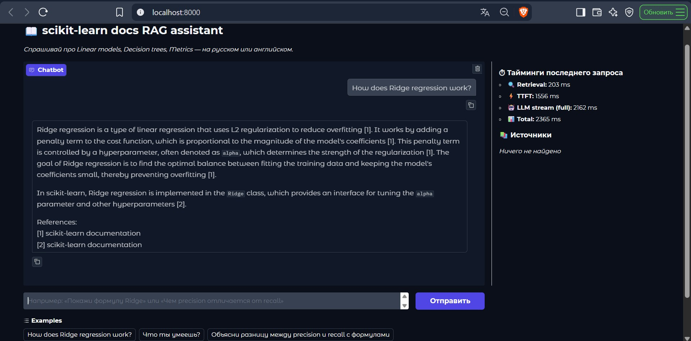
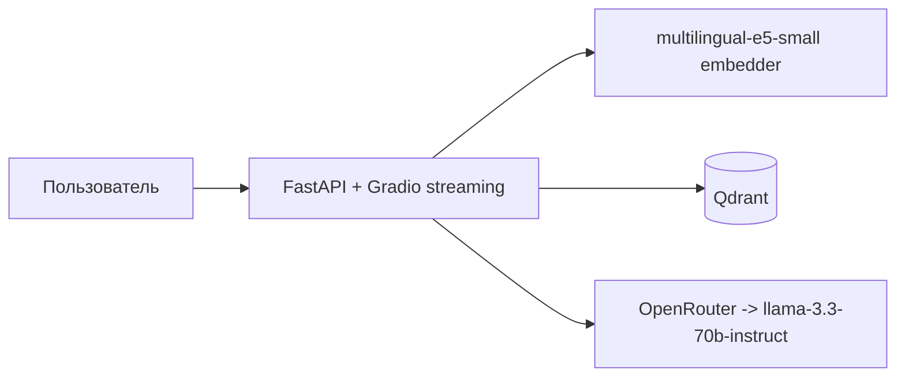

# RAG

AI-ассистент по официальной документации scikit-learn. Задаёте вопрос
на естественном языке — получаете ответ с цитатами из документации.



## Архитектура



## Метрики

Замеры на реальной системе (10 вопросов golden dataset,
10 sklearn-модуля + about.md → 559 чанков, qwen3-next-80b-a3b-instruct,
`notebooks/rag_eval.ipynb`, итог в `notebooks/rag_metrics.json`):

Результаты поиска и оценки ответов на одном наборе вопросов (golden dataset)

| Метрика | Результат | Что проверить по метрикам |
| :--- | :--- | :--- |
| Recall@k (k = top_k = 4) | = 1.00 | Какие вопросы не привели к нужному разделу. Затем сравнить эмбеддеры, размер чанка или top_k на том же наборе |
| Faithfulness | = 0.88 | Какие утверждения не подтверждаются контекстом. Проверить промпт и результат при temperature 0 |
| Response Relevancy | = 0.94 | Где ответ не соответствует вопросу. Проверить найденный контекст и инструкции в промпте |

Ограничения: 10 вопросов, релевантность чанка проверяется по ключевому
слову в URL, а не по разметке самих чанков.

## Локальный запуск

```bash
cp .env.example .env        # впишите LLM_API_KEY
docker compose up -d qdrant
python -m app.scripts.load_corpus
python -m app.scripts.index_corpus
docker compose up -d --build app
```

Откройте <http://localhost:8000>

> RAG-сервис над документацией scikit-learn на FastAPI + LangChain
> LCEL + Qdrant + multilingual-e5-small. Streaming-чат в Gradio
> (TTFT < 1s через chain.stream), оценка качества через RAGAS на
> golden dataset (Recall@4 1.00, Faithfulness 0.88). LLM-провайдер
> абстрагирован через OpenAI-совместимый endpoint — меняется одной
> правкой `app/config.py`.
