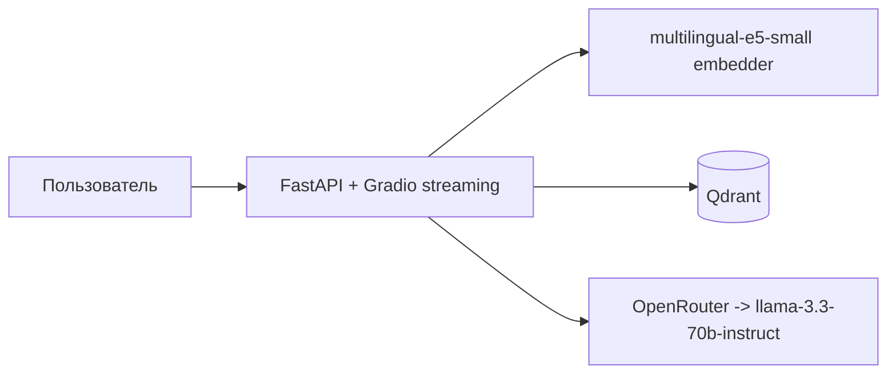

# scikit-learn docs RAG assistant

AI-ассистент по официальной документации scikit-learn. То есть задаётся вопрос
на естественном языке (по-русски или по-английски) на выходе ответ из документации scikit-learn.


## Архитектура



## Корпус

10 модулей документации scikit-learn + внутренняя страница `about.md`
→ **559 чанков** (размер чанка 1000 символов, overlap 200):

linear_model, tree, model_evaluation, ensemble, cross_validation,
preprocessing, compose, grid_search, impute, feature_selection.

## Метрики

Замеры на реальной системе: `notebooks/rag_eval.ipynb`, итог в
`notebooks/rag_metrics.json`. LLM-судья и генератор = `llama-3.3-70b-instruct`,
эмбеддер — `multilingual-e5-small`, top_k = 4. Сравнение до и после расширения корпуса
(базовый прогон — `notebooks/rag_metrics_3modules.json`):

| Метрика | 3 модуля, 10 вопросов | 10 модулей, 17 вопросов | Что измеряет |
| :--- | :---: | :---: | :--- |
| Recall@4 | 1.00 | **1.00** | retriever вернул чанк из нужного раздела документации |
| Faithfulness | 0.88 | **0.86** | LLM-судья: утверждения ответа подтверждаются найденным контекстом |
| Response Relevancy | 0.94 | **0.88** | LLM-судья: ответ соответствует вопросу |

### Ограничения

- Попадание retriever'а проверяется по ключевому слову в URL чанка, то есть на уровне
  раздела документации, а не конкретного абзаца.
- Судья (LLM) и генератор - это одна и та же модель, оценка может быть смещена в пользу модели.
- Вопросы вне корпуса в метриках не участвуют.

## Локальный запуск

```bash
cp .env.example .env        # впишите LLM_API_KEY
docker compose up -d qdrant
python -m app.scripts.load_corpus
python -m app.scripts.index_corpus
docker compose up -d --build app
```

Откройте <http://localhost:8000>

Индексацию запускайте на хосте, а не в контейнере: в образ копируется только `app/`,
а `data/local/about.md` нужен для ответа на вопрос «Что ты умеешь?».

## Тесты

```bash
pytest tests/ -v
```

## резюме

> RAG-сервис над документацией scikit-learn (10 модулей, 559 чанков) на FastAPI +
> LangChain LCEL + Qdrant + multilingual-e5-small. Streaming-чат в Gradio, оценка
> качества через RAGAS на golden dataset из 17 вопросов (Recall@4 1.00,
> Faithfulness 0.86, Response Relevancy 0.88), сравнение метрик до и после
> расширения корпуса. LLM-провайдер абстрагирован через OpenAI-совместимый
> endpoint - меняется одной правкой `app/config.py`.
